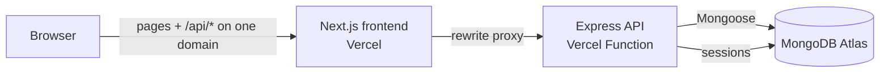

# Kanvas LMS

[](https://kanvas-lms.vercel.app)

### 👉 **Try it live: [kanvas-lms.vercel.app](https://kanvas-lms.vercel.app)**

| Demo role | Username       | Password      |
| --------- | -------------- | ------------- |
| Faculty   | `demo_faculty` | `KanvasDemo1` |
| Student   | `demo_student` | `KanvasDemo1` |

*These are shared demo accounts. You can't change their username, password or role, or delete them. Admin tools are not available in the public demo.*

---

Kanvas is a full-stack learning management system modeled on Canvas. Faculty build courses, modules, assignments and quizzes. Students enroll in courses, take timed quizzes and see their scores. It is built with **Next.js, React, Redux, Express and MongoDB** and runs on **Vercel** and **MongoDB Atlas**.


## Features

**Students**
- Dashboard of enrolled courses, plus a catalog of all courses to enroll in or drop
- Course pages for modules, assignments, quizzes, grades and people
- Quiz taking with a countdown timer, shuffled answers and an attempt limit
- A results page with the score, the points for each question and, if the instructor allows it, the correct answers

**Faculty**
- Create, edit and delete courses
- Manage modules, lessons and assignments (points, available and due dates, assignment groups)
- A quiz builder with Canvas-style settings:
  - type: graded quiz, practice quiz, graded survey or ungraded survey
  - time limit, multiple attempts and maximum attempts
  - shuffle answers, show correct answers, access code
  - one question at a time, lock questions after answering
  - available, due and until dates
- A question editor for **multiple choice**, **true/false** and **fill in the blank** questions
- Publish or unpublish quizzes, and preview a quiz as a student sees it

**Admins**
- User management: filter by role, search by name, create, edit and delete users

**Everyone**
- Sign up as a student or faculty member, sign in, and edit your profile

## Architecture



- **Single-origin API proxy.** The browser only talks to the frontend's domain. Next.js forwards `/api/*` to the Express backend (see [`frontend/next.config.ts`](frontend/next.config.ts)). That makes the session cookie first-party, so login works in Safari and Firefox, which block third-party cookies.
- **Serverless-friendly sessions.** The backend runs as a Vercel Function that can scale to several instances. Sessions are stored in MongoDB with `connect-mongo` instead of server memory, so every instance and every restart sees the same login.
- **Layered backend.** Each resource (users, courses, modules, assignments, enrollments, quizzes, questions, attempts) has its own `schema → model → dao → routes` folder in [`backend/Kambaz/`](backend/Kambaz).

## Security for a public demo

A public demo has to assume that anyone can call the API directly, so the rules are enforced on the server, not just hidden in the UI:

- **Role checks on every write.** Only faculty and admins can create, edit or delete courses, modules and assignments. Only admins can list, create or delete users ([`backend/Kambaz/auth.js`](backend/Kambaz/auth.js)).
- **Users can only change their own data.** Students can enroll in or drop only their own courses. Only an admin can change someone's role, and self sign-up can never create an admin.
- **Passwords never leave the server.** The user model strips `password` from every API response and from stored sessions.
- **Protection against query injection.** Sign-in only accepts plain strings, so a body like `{"password": {"$ne": ""}}` can't skip the password check.
- **Locked demo accounts.** Demo logins can't be deleted or have their username, password or role changed, so every visitor gets a working account. The sample roster accounts in the seed data get random passwords, so only the demo accounts can sign in.

## Testing

- **[`scripts/security-check.sh`](scripts/security-check.sh)** runs 32 checks against a running site through the same `/api` proxy the browser uses. It covers anonymous access, role checks, demo-account locks, the sign-in injection attempt, passwords missing from responses, and the student and faculty flows. It cleans up after itself.
  ```bash
  scripts/security-check.sh https://kanvas-lms.vercel.app             # public checks
  scripts/security-check.sh http://localhost:3000 "$ADMIN_PASSWORD"   # plus admin checks
  ```
- **End-to-end checks** run locally against a throwaway MongoDB and again in production: sign-in through the proxy, sessions surviving a backend restart, and courses, modules, assignments and quizzes loading.
- **The seed script can be re-run safely.** Running it twice adds nothing the second time.

## Tech stack

| Layer    | Tools |
| -------- | ----- |
| Frontend | Next.js 15 (App Router), React 19, TypeScript, Redux Toolkit, React Bootstrap, Axios |
| Backend  | Node.js, Express 5, express-session with connect-mongo |
| Database | MongoDB Atlas, Mongoose 8 |
| Hosting  | Vercel (frontend, and backend as a Vercel Function), MongoDB Atlas M0 |

## Project structure

```
.
├── frontend/                 Next.js app
│   ├── app/(kambaz)/         The LMS: Account, Dashboard, Courses/[cid]/...
│   │   └── Courses/[cid]/    Home, Modules, Assignments, Quizzes, Grades, People
│   ├── app/Labs/             Course lab exercises (Labs 1–5)
│   └── next.config.ts        Proxies /api/* to the backend in production
├── backend/                  Express API
│   ├── index.js              App setup: CORS, sessions, routes
│   ├── seed.js               Loads the demo data into MongoDB
│   └── Kambaz/               auth.js plus one folder per resource
│       └── Database/         Sample data (courses, modules, quizzes, roster)
└── scripts/
    └── security-check.sh     API access-rule checks
```

## Run it locally

You need Node.js 20+ and MongoDB, either installed locally or as an Atlas connection string.

```bash
# 1. Backend: http://localhost:4000
cd backend
npm install
ADMIN_PASSWORD=choose-one npm run seed   # demo data + demo accounts (+ an "admin" login)
npm run dev

# 2. Frontend: http://localhost:3000 (in a second terminal)
cd frontend
npm install
npm run dev
```

Sign in with the demo accounts above. If you set `ADMIN_PASSWORD`, you can also sign in as `admin`. You can run `npm run seed` as often as you like: it never duplicates data, and it resets the demo records to their original state.

### Environment variables

**backend/.env**

| Variable | Purpose | Default |
| -------- | ------- | ------- |
| `DATABASE_CONNECTION_STRING` | MongoDB connection string | `mongodb://127.0.0.1:27017/Kambaz` |
| `SESSION_SECRET` | Signs the session cookie | `kambaz` |
| `CLIENT_URL` | Frontend origin allowed by CORS | `http://localhost:3000` |
| `PORT` | Port for the API | `4000` |
| `ADMIN_PASSWORD` | Seed only: creates a private `admin` login | not set |

**frontend/.env.local**

| Variable | Purpose | Default |
| -------- | ------- | ------- |
| `NEXT_PUBLIC_HTTP_SERVER` | Base URL the app calls for `/api/*` | `http://localhost:4000` |
| `BACKEND_URL` | If set, `/api/*` and `/lab5/*` are proxied to this URL | not set |

## Deployment

| Piece    | Where | Settings |
| -------- | ----- | -------- |
| Frontend | Vercel project (Next.js), deployed from `frontend/` | `NEXT_PUBLIC_HTTP_SERVER` = the frontend's own URL, `BACKEND_URL` = the API URL |
| Backend  | Vercel project (Express, zero config), deployed from `backend/` | `DATABASE_CONNECTION_STRING`, `SESSION_SECRET`, `CLIENT_URL` |
| Database | MongoDB Atlas M0 (AWS us-east-1) | Database `kanvas`, with an app user that can read and write only that database. Filled with `npm run seed`. |

```bash
cd backend  && vercel deploy --prod
cd frontend && vercel deploy --prod
```

The backend runs as a Vercel Function whose outgoing IP address changes, so Atlas network access is open (`0.0.0.0/0`). It's protected by the dedicated database user's strong password and by TLS.

## My contributions

- **Core LMS:** I built the Next.js/Redux frontend (accounts, dashboard, course navigation, modules, assignments, grades, people) and the Node/Express + MongoDB API for users, courses, modules, assignments and enrollments, plus the Labs. These started as individual course assignments.
- **Quiz engine:** I co-developed the quiz builder, question types, attempts and results in a two-person team for the course's final project.
- **Production:**
  - set up the monorepo
  - deployed to Vercel and MongoDB Atlas
  - designed the single-origin proxy and moved sessions to MongoDB
  - hardened the API for public use and created the locked demo accounts
  - wrote the idempotent seed script and the security check suite
  - fixed the issues that blocked the production build

Kanvas started as the final project for the Web Development course at Northeastern University, where the app is called *Kambaz*.

## Possible improvements

- Hash passwords (for example with bcrypt); they are stored as plain text today
- Reset the demo data automatically every day
- Build out the placeholder Calendar, Inbox, Piazza and Zoom pages
- Run the checks in CI
